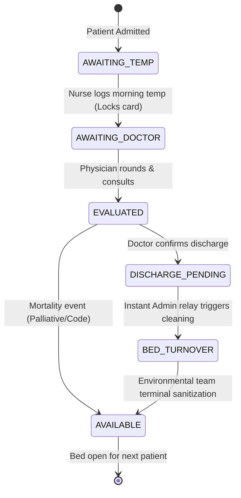

# PULSE RELAY OS — Clinical Asynchronous Relay Engine
### Functional Prototype & Architecture Implementation

A high-performance clinical workflow operating system designed to eradicate the **three root causes of clinic chaos**:
1. **Duplicate Effort** — Prevented via *Lockout Guard* & dynamic button disabling (*Zero Double-Dipping*).
2. **Out-of-Order Visits** — Eliminated via *Strict State Machine Routing* & physician lockout (*"Awaiting Nurse — Do Not Enter"*).
3. **Stagnant Discharge Beds** — Resolved via *Instant Asynchronous Discharge Relays* & rapid terminal cleaning workflows.

---

## 🚀 Live Demo & Deployment to Vercel

This prototype is built with **React + Vite** and is completely pre-configured for **1-click Vercel deployment** (`vercel.json` included).

### Method A: Deploy via Vercel CLI (Instant)
Run the following in the project terminal:
```bash
npx vercel
```
1. Accept the defaults (Vercel will detect Vite automatically via `vercel.json`).
2. Your live URL will be generated within seconds (e.g. `https://pulse-relay-os.vercel.app`).

### Method B: Deploy via GitHub / GitLab
1. Initialize a git repository and commit:
   ```bash
   git init
   git add .
   git commit -m "feat: clinical asynchronous relay engine prototype"
   ```
2. Push to your GitHub repository:
   ```bash
   git remote add origin https://github.com/<your-username>/<your-repo>.git
   git push -u origin main
   ```
3. In [Vercel Dashboard](https://vercel.com/new), click **Import Project**, select the repo, and click **Deploy**.

### Running Locally
```bash
npm install
npm run dev
```
Open [http://localhost:5173](http://localhost:5173) in your browser.

---

## 🏥 Architecture & Workflow Enforcement



---

## 👩‍⚕️ Role 1: Nurse Attending
> **Design Philosophy: Single-Thumb Operational Speed & PPE Ergonomics.**
> *Nurses carry trays, wear protective gloves and PPE, and cannot fiddle with complex nested menus.*

- **Smart Route Queue:** Patients are sorted not merely by room sequence, but by clinical urgency: unchecked rooms (`AWAITING_TEMP`) where temperature is needed first thing in the morning bubble directly to the top. Rooms already checked sink to the bottom.
- **One-Tap Verification:** An oversized temperature drawer with tactile +/- 0.1°F steppers, quick-toggle preset pills (`97.8°F`, `98.6°F`, `99.5°F`, `101.4°F`, `103.2°F`), and integrated Web Audio synthesizer haptic feedback.
- **Lockout Guard:** The instant temperature is confirmed, the room card turns glowing emerald green, displays an audit badge (*"Locked at 07:15 AM by Nurse Kelly"*), and permanently locks against re-entry.
- **Zero Double-Dipping:** Clicking a locked room alerts the nurse and prevents redundant hall patrolling checks.

---

## 👨‍⚕️ Role 2: The Attending Physician
> **Design Philosophy: Protect Doctor Minutes.**
> *Doctors should never touch a thermometer or waste clinician time waiting on unrecorded data.*

- **Filtered Physician Inbox:** Displays exclusively patients whose morning vitals are secured and ready for evaluation.
- **Lockout Shield ("Awaiting Nurse — Do Not Enter"):** Any room lacking vitals is explicitly cordoned off with a protective warning shield to prevent wasted footsteps and premature consults.
- **Clinical Override / Clinical Hold:** If a patient is clinically unstable despite normothermia (e.g. labile blood pressure, sepsis prodrome, internal bleed), the physician can place a **Clinical Hold** with one tap, locking the discharge button until cleared.
- **Instant Discharge Relay:** The instant the doctor orders discharge, an asynchronous dispatch is beamed to the Admin screen without phone calls or paper orders.

---

## 🏢 Role 3: Clinical Operations & Admin
> **Design Philosophy: Bed Velocity & Clinical Survival Guardrails.**

- **Instant Discharge Alert Banner:** Fires the exact millisecond a doctor signs a discharge order, displaying room turnover requirements.
- **Dynamic Mortality Thermometer (Live Mathematical Gauge):**
  $$\text{Rolling Mortality Rate} = \left( \frac{\text{Total Deceased}}{\text{Total Discharged} + \text{Total Deceased}} \right) \times 100$$
  - Real-time animated mercury tube gauge with threshold markers.
  - **Amber Anomaly Flag:** If rolling mortality reaches or exceeds **15.0%**, the system activates a persistent warning flag instructing team leads to audit treatment batches and ICU transfer protocols.
- **Bed Turnover Velocity:** Environmental service controls to mark rooms as undergoing terminal sanitization and reset beds to `AVAILABLE`.
- **Chaos Elimination Dashboard:** Real-time counters showing duplicate checks prevented, sequence enforcement rate, and turnaround velocity.

---

## ⚡ Interactive Preset Testing Bar

Use the top preset chips to test each workflow scenario in 1 click:
1. **Log Fever 102.4°F (Room 102) & Lock** — Demonstrates Smart Queue update, Lockout Guard, and unblocking the room for the physician.
2. **Toggle Clinical Hold (Room 103)** — Demonstrates Clinical Override blocking discharge for unstable normothermic patients.
3. **Order Discharge → Trigger Admin Alert** — Demonstrates asynchronous handoff from Physician to Admin.
4. **Trigger Amber Mortality Anomaly (>15%)** — Demonstrates dynamic mathematical gauge recalculation and team audit flag.
5. **LIVE RELAY Mode** — Displays all three roles side-by-side in real-time.
